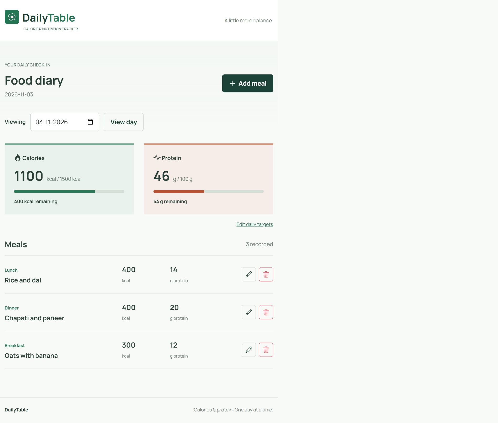
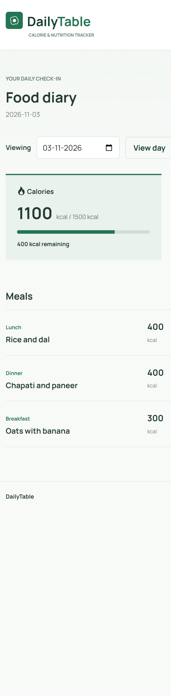
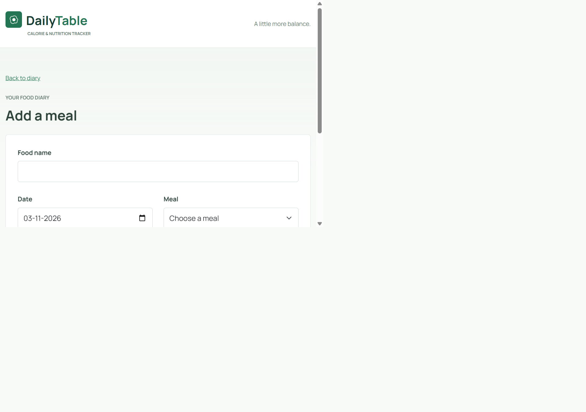
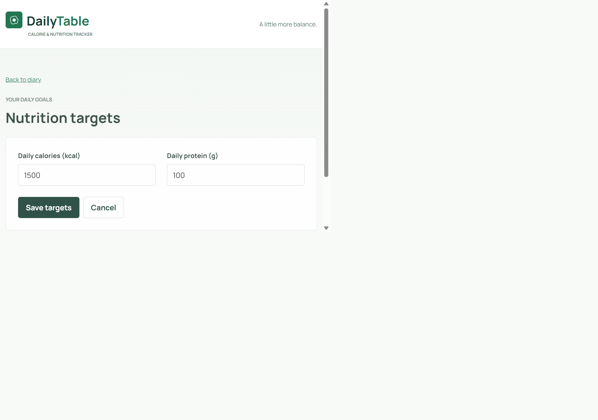

# Calorie and Nutrition Tracker: Prompts, Responses, and Screenshots

**Recorded:** 2026-11-03  
**Project:** Calorie and Nutrition Tracker  
**Application name in the interface:** DailyTable

## About This Record

This document records the project prompts supplied in this chat and the responses for
the corresponding steps. Prompt wording is retained; Markdown emphasis and whitespace
are normalized for readability. Responses are identified as quotations, excerpts, or
summaries so they are not confused with a complete raw chat transcript.

The reusable attached SKILL.md workflow instructions are linked rather than repeated.
Short command invocations are recorded as given. Failed attempts are included because
they explain why some steps were repeated. The screenshots are fresh captures of the
running website, not mockups; capturing them did not change meal records or targets.

## Workflow Overview

| Step | Command or activity | Outcome recorded in the chat |
|------|---------------------|------------------------------|
| 1 | Initial constitution | Blocked by PowerShell execution policy |
| 2 | Specification | Specification and quality checklist created |
| 3 | Target applicability clarification | One current target pair applies to every date |
| 4 | Formal clarification | Reject more than two decimal places |
| 5 | First technical plan request | Blocked by the unfilled constitution |
| 6 | Constitution update | Eight principles adopted as version 1.0.0 |
| 7 | Revised implementation plan | Flask/SQLite design artifacts created |
| 8 | Task generation | 46 implementation tasks generated |
| 9 | First analysis | Two medium and two low findings |
| 10 | Approved remediation | Formatting dependency and numeric notation clarified |
| 11 | Second analysis | Two non-blocking low findings remained |
| 12 | Implementation and environment setup | Virtual environment created; Flask installed after network recovery |
| 13 | Launch attempts | Missing tracker package identified |
| 14 | Implementation fix | Application implemented, tested, and started |

## 1. Initial Constitution Request

**Workflow:** /speckit-constitution  
**Instructions:** [Constitution skill](../.github/skills/speckit-constitution/SKILL.md)

### User Prompt

```text
Create a simple project constitution for a Calorie and Nutrition Tracker application.

The application should allow users to:

- Record daily meals, including breakfast, lunch, dinner, and snacks.
- Enter meal details such as food name, calories, and protein.
- Track total daily calorie and protein intake.
- Set daily calorie and protein targets.
- View daily progress by comparing actual intake against targets.

Include the following principles and constraints in the constitution:

1. Simplicity: Keep the application simple, user-friendly, and suitable for a fundamentals-level project.
2. Accuracy: Ensure calorie and protein calculations are accurate.
3. Data Validation: Validate user inputs and handle invalid or missing values appropriately.
4. Maintainability: Follow clean coding practices and maintain a clear project structure.
5. Usability: Provide a simple and understandable interface for recording meals and viewing nutrition progress.
6. Data Management: Store and retrieve meal records and daily nutrition targets consistently.
7. Testing: Validate all major functionalities, including normal inputs, invalid inputs, boundary conditions, and edge cases.
8. Error Handling: Display appropriate error messages and handle unexpected situations gracefully.
```

## 2. Functional Specification Request

**Workflow:** /speckit-specify  
**Instructions:** [Specification skill](../.github/skills/speckit-specify/SKILL.md)

### User Prompt

```text
Create a detailed functional specification for a Calorie and Nutrition Tracker application based on the following requirements.

1. Project Overview
Build a simple application that helps users record their daily food intake, monitor calories and protein consumption, set nutrition targets, and track their daily progress.

2. Target Users

- Individuals who want to monitor their daily food intake.
- Users who want to track calories and protein.
- Users who want to compare their daily nutrition intake against personal targets.

3. Functional Requirements

Meal Management

- Users must be able to add meals with a food name, meal category, calorie amount, and protein amount.
- Support predefined meal categories: Breakfast, Lunch, Dinner, and Snacks.
- Users must be able to view their recorded meals.
- Users must be able to edit and delete existing meal records.

Nutrition Tracking

- The application must calculate the total calories consumed for a selected day.
- The application must calculate the total protein consumed for a selected day.
- Nutrition totals must update whenever a meal is added, edited, or deleted.
- Users must be able to view a daily summary of their calorie and protein intake.

Daily Nutrition Targets

- Users must be able to set daily calorie and protein targets.
- Users must be able to update their targets.
- The application must compare actual calorie and protein intake against the configured targets.

Daily Progress

- Display actual calorie intake against the daily calorie target.
- Display actual protein intake against the daily protein target.
- Show remaining calories and protein when intake is below the target.
- Clearly indicate when the user has reached or exceeded a target.
- Display progress using simple progress indicators.

4. Business Rules

- Each meal must have a food name and valid nutrition values.
- Calories and protein must not accept negative values.
- Meal category must be selected from the predefined categories.
- Daily totals must include all meals recorded for the selected date.
- Adding, editing, or deleting a meal must update the daily totals.
- Progress must be calculated using the user's configured daily targets.
- If no target is configured, the application should prompt the user to set one instead of displaying misleading progress.

5. Input Validation

- Food name cannot be empty.
- Calories and protein must be valid non-negative numeric values.
- Daily calorie and protein targets must be valid positive numbers.
- Required fields must be validated before saving.
- Display clear validation messages for invalid inputs.

6. Scope
Include:

- Meal creation, viewing, editing, and deletion.
- Daily calorie and protein calculations.
- Daily nutrition target management.
- Daily progress tracking.
- Basic input validation and error handling.

Exclude:

- User authentication and registration.
- Food database or automatic nutrition lookup.
- Barcode scanning.
- AI-based meal recommendations.
- Social sharing and community features.
- Advanced analytics and diet planning.

7. Assumptions and Constraints

- This is a beginner-level application intended to demonstrate fundamental software development concepts.
- Users manually enter food names and nutrition values.
- Nutrition values are entered per meal.
- The application focuses only on calories and protein.
- The application should support tracking meals by date.
- Keep the interface and functionality simple.

8. Acceptance Criteria
Create uniquely identified acceptance criteria using IDs such as AC-01, AC-02, etc.

Include acceptance criteria for:

- Adding a meal successfully.
- Viewing recorded meals.
- Editing and deleting meals.
- Validating meal inputs.
- Calculating daily calorie totals.
- Calculating daily protein totals.
- Setting and updating daily targets.
- Comparing actual intake with targets.
- Displaying remaining or exceeded nutrition values.
- Updating progress after meal modifications.
- Handling days with no recorded meals.
- Handling days when nutrition targets are not configured.

9. Non-Functional Requirements

- The application should be easy to use and understand.
- Calculations should be accurate.
- Data should be stored and retrieved consistently.
- The application should provide clear error messages.
- Code should be maintainable and organized.

Generate the specification in a clear, structured format. Separate functional requirements, business rules, assumptions, constraints, and acceptance criteria. Ensure every acceptance criterion has a unique ID and is specific, measurable, and testable.

Do not introduce additional features or complex requirements beyond the defined project scope. Clearly identify any decisions that still require business-owner clarification instead of treating assumptions as confirmed requirements.
```

### Response (Summary)

- Created the feature directory specs/001-calorie-nutrition-tracker/.
- Created the specification with 23 uniquely identified acceptance criteria.
- Created a separate specification-quality checklist.
- Reported 11 of 16 checklist items passing while target applicability was unresolved.
- Asked whether targets are date-specific, carry forward from an effective date, or are
  one current pair used for every date.

**Artifacts:** [Specification](../specs/001-calorie-nutrition-tracker/spec.md),
[quality checklist](../specs/001-calorie-nutrition-tracker/checklists/requirements.md).

## 3. Target Applicability Decision

### User Reply

```text
c. One current target pair applies to every date
```

## 4. Formal Clarification

**Workflow:** /speckit-clarify  
**Instructions:** [Clarification skill](../.github/skills/speckit-clarify/SKILL.md)

> Quality checklist: 16/16 -> 16/16 passing. No state changes, regressions, or unchecked
> items. No extension hooks configured.

**Result:** The precision rule was integrated into requirements, business rules, validation,
acceptance criteria, and the clarification log.

## 5. First Technical Planning Request

**Workflow:** /speckit-plan  
**Instructions:** [Planning skill](../.github/skills/speckit-plan/SKILL.md)

### User Prompt

```text
Create a simple and practical technical implementation plan for the Calorie and Nutrition Tracker based on the approved constitution and specification.

Use the following technology stack:

- Programming Language: Python
- Backend Framework: Flask
- Frontend: HTML, CSS, and Bootstrap
- Database: SQLite
- API Testing: Postman (if APIs are implemented)

Include:

1. Overall system architecture and project structure.
2. Application components and their responsibilities.
3. Database design for storing meals and daily nutrition targets.
4. Backend routes and API endpoints for meal management and nutrition tracking.
5. Processing flow for adding, editing, deleting meals, and calculating daily nutrition totals.
6. Daily calorie and protein progress calculation.
7. Input validation and error-handling strategies.
8. Testing approach covering functional requirements and edge cases.

Keep the implementation simple and suitable for a fundamentals-level assignment.

Follow the approved constitution and specification. Ensure the technical plan aligns with the acceptance criteria. Avoid unnecessary features, technologies, and complex architecture.
```

## 6. Constitution Change Request

**Workflow:** /speckit-constitution

### User Prompt

```text
Update the existing Calorie and Nutrition Tracker constitution by replacing or refining its current principles with the following eight principles:

1. Simplicity: Keep the application simple and suitable for a fundamentals-level project.
2. Accuracy: Ensure calorie and protein calculations are accurate and consistent.
3. User-Friendly Design: Provide an intuitive and responsive interface.
4. Input Validation: Reject invalid inputs, including negative calorie and protein values.
5. Maintainability: Follow clean coding practices and maintain a modular, readable structure.
6. Data Integrity: Ensure meal records and nutrition targets are stored and retrieved reliably.
7. Testing: Verify normal, invalid, boundary, and edge-case scenarios.
8. Error Handling: Handle application and database errors gracefully.

Also ensure the constitution includes clear governance and development guidelines.

Important:

- Update the existing constitution; do not create a new one.
- Preserve its existing structure where appropriate.
- Remove outdated principles and unresolved template placeholders.
- Do not include technology-specific restrictions.
- Keep the constitution concise and project-specific.
- Do not modify the specification, plan, or other project files.
```

## 7. Revised Technical Implementation Plan

**Workflow:** /speckit-plan

### User Prompt

```text
Create a detailed but simple technical implementation plan for my existing Calorie and Nutrition Tracker based on the approved constitution and specification.

Technology Stack:

- Programming Language: Python
- Backend Framework: Flask
- Frontend: HTML, CSS, Bootstrap
- Database: SQLite
- Testing: Python unittest and Flask test client

Plan should cover:

1. Application architecture and components.
2. Responsibilities of Flask routes, frontend pages, and database.
3. Database design for storing meals and daily nutrition targets.
4. Meal management: add, view, edit, and delete meals.
5. Daily calorie and protein calculations.
6. Setting and updating reusable daily nutrition targets.
7. Dashboard displaying intake, remaining values, and progress.
8. Input validation and error handling.
9. Testing strategy covering normal, invalid, boundary, and edge cases.

Processing Flow:

- Accept meal details from the user.
- Validate the submitted information.
- Store valid meal records in SQLite.
- Retrieve meals based on the selected date.
- Calculate daily calorie and protein totals.
- Compare totals against daily targets.
- Display progress on the dashboard.

Constraints:

- Keep the implementation beginner-friendly and maintainable.
- Follow the existing constitution and approved specification.
- Do not introduce unnecessary dependencies.
- Do not require Postman.
- Preserve all agreed business rules and acceptance criteria.

Generate a feasible implementation plan with clear components, processing steps, data handling, and error handling. Do not introduce features outside the approved scope.
```

### Generated Artifacts

- [Implementation plan](../specs/001-calorie-nutrition-tracker/plan.md).
- [Research decisions](../specs/001-calorie-nutrition-tracker/research.md).
- [Data model](../specs/001-calorie-nutrition-tracker/data-model.md).
- [Browser route contracts](../specs/001-calorie-nutrition-tracker/contracts/browser-routes.md).
- [Quickstart and validation guide](../specs/001-calorie-nutrition-tracker/quickstart.md).

## 8. Task Generation

**Workflow:** /speckit-tasks  
**Instructions:** [Task-generation skill](../.github/skills/speckit-tasks/SKILL.md)

**Artifact:** [Implementation tasks](../specs/001-calorie-nutrition-tracker/tasks.md).

## 9. First Cross-Artifact Analysis

**Workflow:** /speckit-analyze  
**Instructions:** [Analysis skill](../.github/skills/speckit-analyze/SKILL.md)

### Response (Summary)

The read-only report found four issues:

| ID | Severity | Finding | Suggested correction |
|----|----------|---------|----------------------|
| I1 | MEDIUM | US1 displays meal amounts before shared formatting is implemented in US2. | Move shared formatting earlier. |
| A1 | MEDIUM | The plan restricts numeric notation more explicitly than the specification. | Agree and document accepted numeric syntax. |
| I2 | LOW | The specification still calls the adopted constitution an unratified scaffold. | Correct the stale dependency note. |
| D1 | LOW | T009 and T016 overlap on validation tests. | Consolidate or make T016 explicitly incremental. |

The report counted 20 buildable requirements, 46 tasks, and 100% task coverage. All
23 acceptance criteria were referenced. No confirmed constitution MUST-rule violations
or unmapped tasks were reported. No files were modified during analysis.

The assistant asked:

> Would you like me to suggest concrete remediation edits for the top 2 issues?

## 10. Remediation Approval and Changes

### User Reply

```text
yes
```

### Proposed Response (Excerpt)

> 1. I1: Move exact formatting earlier. Update T010 to include a shared integer-hundredths
> formatting helper, with tests in T009. Have US1 reuse it for meal lists and edit forms.
> Remove formatting implementation from T026, leaving daily summation there.
>
> 2. A1: Define numeric notation explicitly. Recommended rule: accept digits with an
> optional decimal point followed by one or two digits, such as 0, 0.5, and 100.25.
> Reject .5, +1, exponent notation, and excess precision. Add this rule to the
> specification and matching cases to T009.
>
> Do you approve both edits, including the recommended numeric notation?

### User Approval

```text
yes
```

### Response After Applying the Changes (Quotation)

> Applied both approved fixes across the specification, plan, and tasks.
>
> Shared exact formatting now precedes US1. Numeric notation is explicit, with acceptance
> examples for valid and rejected inputs.
>
> Validation passed: 46 task IDs and 23 acceptance IDs preserved, with no editor errors.
> The two lower-priority findings remain unchanged.

**Agreed notation:** After trimming surrounding whitespace, the complete numeric string
matches `[0-9]+(?:\.[0-9]{1,2})?`. Meal values may be zero; target values must be positive.

## 11. Second Cross-Artifact Analysis

**Workflow:** /speckit-analyze

### Response (Summary)

- Confirmed I1 and A1 resolved.
- Retained I2 and D1 as two non-blocking LOW findings.
- Reported zero critical, high, or medium findings.
- Reported 20 counted requirements, 46 tasks, 100% task coverage, and all 23 acceptance
  criteria referenced.
- Reported no constitution conflicts or unmapped tasks.
- Recommended proceeding with /speckit-implement, with optional low-priority cleanup.
- Made no file changes.

The assistant offered concrete remediation suggestions for the remaining two issues;
the subsequent conversation moved to implementation instead.

## 12. Implementation and Python Environment Setup

**Workflow:** /speckit-implement  
**Instructions:** [Implementation skill](../.github/skills/speckit-implement/SKILL.md)

### User Prompt

```text
/speckit-implement
```

### Initial Response (Summary)

The assistant reported that implementation would proceed phase by phase, that the
requirements checklist passed 16/16, and that real participants were needed for the
five-user walkthrough. At this stage the application package had not yet been created.

### Final Response (Quotation)

> The application started successfully.
>
> Open Calorie Tracker: http://127.0.0.1:5000.
>
> Meal management, daily totals, targets, and progress are working. 32 tests pass, checks completed.
>
> The five-person usability walkthrough and final sign-off remain pending.

**Implementation entry point:** [Application factory](../tracker/__init__.py).  
**Validation evidence:** [Quickstart results](../specs/001-calorie-nutrition-tracker/quickstart.md).  
**Run instructions:** [README](../README.md).

## 15. Website Screenshots

Captured from the running website on 2026-11-03. Desktop viewport: 1280 x 900;
mobile viewport: 375 x 812. Screenshots are full-page captures, so image height may exceed
the viewport height. The populated dashboard reflects the records and targets present
at capture time; the figures below are not defaults or automatically supplied food values.

### Desktop Dashboard

The selected day shows three meals, 1100 kcal and 46 g protein, with targets of
1500 kcal and 100 g protein. Remaining values are 400 kcal and 54 g protein.



### Mobile Dashboard

The same diary and progress summaries at mobile width.



### Add Meal Page

Food name, date, one of the four meal categories, calories in kcal, and protein in grams.



### Nutrition Targets Page

One current calorie/protein target pair reused across all selected dates.



## 16. Project Artifacts

| Artifact | File |
|----------|------|
| Constitution | [constitution.md](../.specify/memory/constitution.md) |
| Specification | [spec.md](../specs/001-calorie-nutrition-tracker/spec.md) |
| Quality checklist | [requirements.md](../specs/001-calorie-nutrition-tracker/checklists/requirements.md) |
| Implementation plan | [plan.md](../specs/001-calorie-nutrition-tracker/plan.md) |
| Research | [research.md](../specs/001-calorie-nutrition-tracker/research.md) |
| Data model | [data-model.md](../specs/001-calorie-nutrition-tracker/data-model.md) |
| Browser contracts | [browser-routes.md](../specs/001-calorie-nutrition-tracker/contracts/browser-routes.md) |
| Task checklist | [tasks.md](../specs/001-calorie-nutrition-tracker/tasks.md) |
| Validation record | [quickstart.md](../specs/001-calorie-nutrition-tracker/quickstart.md) |
| Run instructions | [README.md](../README.md) |
