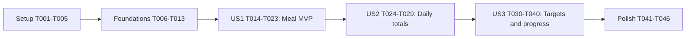

# Tasks: Calorie and Nutrition Tracker

**Input**: Design documents in specs/001-calorie-nutrition-tracker/.
**Prerequisites**: [plan.md](plan.md), [spec.md](spec.md), [research.md](research.md),
[data-model.md](data-model.md), [browser routes](contracts/browser-routes.md),
[quickstart.md](quickstart.md), and [constitution v1.0.0](../../.specify/memory/constitution.md).
**Tests**: Required by the specification and constitution; use Python unittest and Flask
test client, not pytest or Postman. Write story tests first and observe relevant failures
before implementing their behavior. Tests must not require later-story behavior to pass.
**Organization**: Setup, shared foundations, three priority-ordered user stories, then polish.
**Status**: Implementation completed through automated/browser verification. T043 requires
real first-time users and T046 final acceptance depends on that result; both remain pending.

## Format: `[ID] [P?] [Story] Description`

- Each task starts with an unchecked checkbox and a unique sequential ID.
- `[P]` means different files can be worked on together after their stated prerequisites.
- `[US1]`, `[US2]`, and `[US3]` identify story tasks; infrastructure/polish have no story label.
- Paths are repository-relative. Planned files need to be created during implementation.

## Path Conventions

Use the single tracker/ package, tracker/templates/, tracker/static/, and tests/ layout
from the plan. Runtime data belongs in instance/nutrition.sqlite3, never static assets.
No additional API, ORM, authentication, deployment, or frontend build system is required.

## Phase 1: Setup (Shared Infrastructure)

**Purpose**: Establish the minimal Python/Flask project and locally available styling.

- [X] T001 Create requirements.txt with a pinned compatible Flask 3.1.x release and record the selected Python 3.12+ version in README.md; install in a local virtual environment without adding test/ORM/API dependencies.
- [X] T002 [P] Create or extend .gitignore to exclude .venv/, instance/, local secrets, __pycache__/, and Python bytecode without removing existing user rules.
- [X] T003 [P] Vendor pinned Bootstrap 5.3 CSS and its upstream license into tracker/static/vendor/bootstrap.min.css and tracker/static/vendor/bootstrap.LICENSE; do not require a CDN or Bootstrap JavaScript.
- [X] T004 Create the configurable application factory in tracker/__init__.py with a local instance database default, TRACKER_SECRET_KEY configuration, and test-config overrides for database path and secret; fail clearly on missing required secret outside tests.
- [X] T005 Document environment creation, requirements installation, stable local secret configuration, localhost-only Flask launch, and unittest discovery commands in README.md using the approved quickstart conventions.

**Checkpoint**: The factory imports in the chosen environment; only Flask and its normal
dependencies are required. T002 and T003 can run together after T001; T004 follows T001,
and T005 follows T004. Do not initialize source files by overwriting unrelated work.

## Phase 2: Foundational (Blocking Prerequisites)

**Purpose**: Shared schema, transaction boundaries, validation, tokens, and error behavior.
All foundation tasks must finish before story implementation begins.

- [X] T006 Define meals, nutrition_targets, and submission_receipts in tracker/schema.sql with the exact field constraints quoted in the Schema Constraints subsection below; add the meal_date index and non-destructive initialization, without stored totals or target history.
- [X] T007 Implement request-scoped sqlite3.Row connections, autocommit=False, transaction/rollback behavior, teardown closure, and a non-destructive init-db CLI in tracker/db.py; register lifecycle/CLI hooks in tracker/__init__.py and initialize target row 1 only when absent (depends on T004, T006).
- [X] T008 Establish a reusable unittest fixture in tests/__init__.py using TemporaryDirectory, per-test application/client, token extraction with standard-library HTMLParser, and Windows-safe connection cleanup; add initialization/rollback/teardown smoke tests in tests/test_persistence.py using real SQLite (depends on T007).
- [X] T009 Add subTest cases in tests/test_validation.py for meal/target numeric rules, canonical valid/invalid/leap dates, all categories, blank names, zero versus missing, NaN/infinity, accepted 0/0.5/100.25 notation, rejected .5/+1/1./1e2/1.234/1.230 notation, and the 64-bit bound; add foundational exact formatter tests in tests/test_nutrition.py for 0 -> 0, 50 -> 0.5, 10025 -> 100.25, insignificant zeros, and large integer values without float; observe failures before T010 (depends on T008).
- [X] T010 Implement shared field validators in tracker/validation.py: trim nonblank food names; exact four-category membership; canonical datetime.date validation; after whitespace trimming require a full match of [0-9]+(?:\.[0-9]{1,2})?; finite Decimal-from-string parsing without rounding; non-negative meals and positive targets; bound numeric token length and scaled values before conversion; implement the shared integer-hundredths amount formatter in tracker/nutrition.py without float, available before US1 (depends on T009).
- [X] T011 Implement the reusable atomic submission-receipt protocol in tracker/db.py with deterministic json.dumps payloads, targeted key conflict handling, replay-before-record-existence checks, matching 303 destinations, conflicting-intent detection, and rollback of pending receipts with failed mutations; retain receipts after meal deletion (depends on T007, T010).
- [X] T012 Establish shared route registration, session CSRF validation, distinct per-form submission keys, safe canonical-date redirects, and 400/404/409/422/503/500 response helpers in tracker/routes.py and tracker/__init__.py; create tracker/templates/base.html and tracker/templates/error.html with escaped messages and local Bootstrap, preserving inputs/key on failed writes and never exposing SQL/tracebacks (depends on T003, T010, T011).
- [X] T013 Extend foundation tests in tests/test_persistence.py and tests/test_validation.py to cover receipt commit/rollback/conflict and repeated init-db preservation; run these checks and foundational formatter tests in tests/test_nutrition.py, record actual results in specs/001-calorie-nutrition-tracker/quickstart.md, and resolve failures before story work (depends on T008-T012).

### Schema Constraints

T006 must reproduce these data-model constraints verbatim in intent; both application
validation and database CHECK/NOT NULL constraints apply where specified:

| Table.field | Type and quoted constraint |
|-------------|----------------------------|
| meals.id | INTEGER PRIMARY KEY; "Generated immutable identity; never identify by food name" |
| meals.meal_date | TEXT NOT NULL; "Valid calendar date; index for selected-date queries" |
| meals.food_name | TEXT NOT NULL; "Trimmed and nonblank; duplicates allowed" |
| meals.category | TEXT NOT NULL; "Breakfast, Lunch, Dinner, or Snacks" |
| meals.calories_hundredths | INTEGER NOT NULL; "Actual integer storage type; value >= 0" |
| meals.protein_hundredths | INTEGER NOT NULL; "Actual integer storage type; value >= 0" |
| nutrition_targets.id | INTEGER PRIMARY KEY; "CHECK id = 1; at most one row" |
| nutrition_targets.calorie_target_hundredths | INTEGER nullable; "NULL or actual integer > 0" |
| nutrition_targets.protein_target_hundredths | INTEGER nullable; "NULL or actual integer > 0" |
| submission_receipts.submission_key | TEXT PRIMARY KEY NOT NULL; "Random server-issued form token" |
| submission_receipts.operation | TEXT NOT NULL; "add_meal, edit_meal, delete_meal, save_targets" |
| submission_receipts.resource_id | INTEGER nullable; "Meal ID for edit/delete; NULL otherwise" |
| submission_receipts.payload_json | TEXT NOT NULL; "Canonical validated fields/return context, excluding tokens" |
| submission_receipts.redirect_path | TEXT NOT NULL; "Validated app-local dashboard destination" |

T010 must enforce "Each stored value must fit 0..9223372036854775807 units" without float
conversion. Actual dates and fractional-digit precision are server validations, not merely
SQL shape checks. No cascading foreign key may erase receipts, and no content uniqueness
may prohibit identical meals. See [data-model.md](data-model.md) for all lifecycle rules.

**Checkpoint**: Isolated tests can use real SQLite, tokens, exact validators, and atomic
replay-safe mutations. Startup/init must not drop or reset existing business data.

## Phase 3: User Story 1 - Record and Manage Daily Meals (Priority: P1) MVP

**Goal**: Add, list, edit, move, and delete dated meals with clear validation and safe retries.
**Independent Test**: Without configuring targets or requiring daily totals, save a meal,
view it for its date, edit its details/date, delete it, and reject invalid submissions.
Use AC-01, AC-02, AC-03, AC-04's list behavior, AC-05, AC-06, AC-20, and meal parts of
AC-18/AC-21; total/progress clauses are completed in US2/US3.

### Tests for User Story 1

- [X] T014 [P] [US1] Write meal browser-contract tests in tests/test_routes.py for GET / and date selection, GET/POST /meals/new, GET/POST /meals/<int:meal_id>/edit, POST /meals/<int:meal_id>/delete, 303 redirects, 422 field errors, CSRF/invalid dates/missing IDs, preserved inputs, and escaped names (AC-01, AC-02, AC-03, AC-04, AC-05, AC-06; depends on Phase 2).
- [X] T015 [P] [US1] Write meal lifecycle/persistence/failure tests in tests/test_persistence.py covering identity, separate identical meals, date moves, all four categories, reopen after edits/deletion, execute/commit rollback, lost-response same-key replay, fresh-key duplicate allowance, replay conflict and replay after deletion (AC-18, AC-19, AC-20, AC-21; depends on Phase 2).
- [X] T016 [P] [US1] Add meal-specific validation tests in tests/test_validation.py for required fields, whitespace food name, category tampering, malformed/leap dates, zero/decimal values, finite/non-negative constraints, and no rounding of excess precision (AC-05, AC-06; depends on Phase 2).

### Implementation for User Story 1

- [X] T017 [US1] Implement parameterized list/get/create/update/delete meal helpers in tracker/db.py using immutable IDs, exact-date filtering, stable ID ordering, integer hundredths, and atomic receipts; ensure updates/deletions affect one record only and date edits require no cached-total writes (depends on T014-T016).
- [X] T018 [US1] Implement GET / with selected-date meal retrieval and GET/POST /meals/new in tracker/routes.py using shared validation, form tokens, committed 303 redirects, and failed-read errors rather than empty-day fallbacks (depends on T017).
- [X] T019 [US1] Build tracker/templates/meal_form.html for both add and edit with date/name/category/calorie/protein fields, kcal/g labels, hidden tokens, native input hints, associated field errors, and a focusable error summary; retain invalid values, use only the four categories, and reuse T010's tracker/nutrition.py formatter for saved edit-form amounts rather than displaying scaled integers or duplicating conversion (depends on T010, T018).
- [X] T020 [US1] Implement GET/POST /meals/<int:meal_id>/edit and POST /meals/<int:meal_id>/delete in tracker/routes.py, validating dates/tokens and replay before missing-record checks; redirect edits to their resulting date and deletion to validated return_date, never mutating on GET (depends on T017, T019).
- [X] T021 [US1] Build the date selector, date-filtered meal list, add/edit links, tokenized POST delete controls, and genuine empty-list state in tracker/templates/dashboard.html, reusing T010's tracker/nutrition.py formatter for meal amounts without requiring target setup or unfinished totals/progress behavior (depends on T010, T018, T020).
- [X] T022 [US1] Connect meal failure/retry handling across tracker/routes.py and tracker/db.py so unsuccessful writes retain inputs/key, read failures are not empty days, success is shown only after commit, and replay cannot duplicate a change while fresh keys permit identical meals (depends on T020, T021).
- [X] T023 [US1] Run US1 validation/route/persistence unittest cases, repair only this story's failures, and record actual results and meal-only MVP demonstration steps in specs/001-calorie-nutrition-tracker/quickstart.md (depends on T014-T022).

**Checkpoint**: A usable meal-record MVP works without US2 totals or US3 target management.

## Phase 4: User Story 2 - Review Daily Nutrition Totals (Priority: P2)

**Goal**: Accurate calorie/protein totals for a selected day, updated after meal changes.
**Independent Test**: Seed known meals on two dates without targets; verify date-isolated
totals, decimal exactness, zero-meal behavior, and changes after add/edit/delete/move.

### Tests for User Story 2

- [X] T024 [P] [US2] Extend tests/test_nutrition.py with daily sum tests for 1500-calorie and 85-protein fixtures, empty sums, 0.1 + 0.2 = 0.3, duplicate meals, maximum stored values, and daily sums beyond SQLite's 64-bit SUM range; verify totals use T010's existing exact formatter without float rather than duplicating its foundational unit tests (AC-07, AC-08, AC-10, AC-20, AC-23; depends on US1 checkpoint).
- [X] T025 [P] [US2] Extend tests/test_routes.py and tests/test_persistence.py with date-isolated daily summaries, zero totals after the last deletion, refreshed totals after each meal mutation/date move, reopen exactness, and read-failure-not-zero assertions (AC-04, AC-09, AC-10, AC-16, AC-18, AC-19, AC-21, AC-23; depends on US1 checkpoint).

### Implementation for User Story 2

- [X] T026 [US2] Implement pure integer-hundredths daily summation in tracker/nutrition.py using fetched records and Python integers rather than SQLite SUM or float; return zero for a genuine empty record set and reuse T010's shared exact amount formatter without reimplementing formatting (depends on T010, T024, T025).
- [X] T027 [US2] Extend GET / in tracker/routes.py to calculate both totals from successfully retrieved selected-date meals in one read snapshot and provide formatted values to templates; preserve explicit retrieval failures and avoid cached summary writes (depends on T026).
- [X] T028 [US2] Add clearly labeled kcal/g daily summaries and zero-day values to tracker/templates/dashboard.html; ensure add/edit/delete navigation shows current totals without reopening and values from other dates never leak into the selected day (depends on T027).
- [X] T029 [US2] Run US1 regressions plus US2 unittest cases, verify the exact AC-07/AC-08 fixtures and both sides of a date move, and record actual outcomes in specs/001-calorie-nutrition-tracker/quickstart.md (depends on T024-T028).

**Checkpoint**: Daily totals work independently of configured targets; US1 remains usable.

## Phase 5: User Story 3 - Set Targets and Monitor Progress (Priority: P3)

**Goal**: Set/update one reusable positive target pair and show accurate per-nutrient progress.
**Independent Test**: With fixed seeded meals, set/update targets and verify below, reached,
exceeded, mixed-nutrient, empty-day, missing-target, and historical-date comparisons.

### Tests for User Story 3

- [X] T030 [P] [US3] Extend tests/test_nutrition.py with exact integer remaining/exceeded comparisons, Decimal indicator fill clamped at 100, zero-meal full-remaining behavior, independently absent targets, near-equality rounding boundaries, and all AC-13/AC-14/AC-15 fixtures (depends on US2 checkpoint).
- [X] T031 [P] [US3] Extend tests/test_routes.py with GET/POST /targets contract cases, positive/decimal goals, required-field/zero/negative/non-finite/1.234/1.230 rejection, 303/422 status and unchanged invalid goals, progress after every meal mutation, and both/one absent target prompts (AC-10, AC-11, AC-12, AC-16, AC-17; depends on US2 checkpoint).
- [X] T032 [P] [US3] Extend tests/test_persistence.py with singleton NULL/positive target states, upsert/reopen preservation, execute/commit rollback and same-key replay for target updates, and exact two-date AC-22 targets 2000/100 -> 1800/90 without changing meal rows (AC-18, AC-21, AC-22; depends on US2 checkpoint).

### Implementation for User Story 3

- [X] T033 [US3] Add shared target-form validation in tracker/validation.py requiring both positive values, the confirmed scale/bounds, and canonical return_date; reject blanks rather than clearing existing goals and reuse numeric rules instead of duplicating them (depends on T030-T032).
- [X] T034 [US3] Implement current-target read/upsert helpers in tracker/db.py using only singleton ID 1, independently nullable read states, positive atomic pair writes and receipt integration; introduce no dates/history columns or goal-removal operation (depends on T033).
- [X] T035 [US3] Implement per-nutrient progress in tracker/nutrition.py: remaining=max(T-I,0), exceeded=max(I-T,0), exact below/reached/exceeded states, Decimal fill=min(100,100*I/T), and absent target outputs without division or misleading status (depends on T030, T034).
- [X] T036 [US3] Implement GET/POST /targets and extend dashboard reads in tracker/routes.py to fetch meals/current targets in one snapshot, use shared progress helpers, preserve error inputs/key, and redirect to validated return_date only after committed writes (depends on T034, T035).
- [X] T037 [US3] Build tracker/templates/targets.html with current positive calorie/protein goals, kcal/g labels, return_date/tokens, associated errors, retained invalid entries, and clear save/cancel navigation; do not add date-specific targets or removal controls (depends on T036).
- [X] T038 [US3] Add actual/current-target values, remaining/reached/exceeded text, clamped native progress indicators, and per-nutrient target setup prompts to tracker/templates/dashboard.html; omit numeric percentage labels and missing-target progress while retaining visible intake (depends on T036, T037).
- [X] T039 [US3] Complete target read/write/retry error integration in tracker/routes.py and tracker/db.py so database failures cannot masquerade as absent targets, historical dates always reuse the latest pair, and invalid/failed goal updates preserve prior values (depends on T038).
- [X] T040 [US3] Run all three stories' unittest cases, confirm exact AC-12 through AC-17 and AC-22 examples after save/reopen, and record actual outcomes in specs/001-calorie-nutrition-tracker/quickstart.md (depends on T030-T039).

**Checkpoint**: All approved meal, totals, target, progress, persistence, and retry workflows
are implemented and covered. A current target change alters historical comparisons only.

## Phase 6: Polish & Cross-Cutting Concerns

**Purpose**: Verify usability, documentation, maintainability, and complete acceptance coverage.

- [X] T041 Refine tracker/static/styles.css and tracker/templates/base.html for 375px/1280px responsive layouts, visible keyboard focus, readable text/units, stacked controls, associated errors, and non-color statuses; avoid overlapping/clipped controls and preserve local Bootstrap without introducing dependencies (depends on all stories).
- [X] T042 Verify keyboard-only meal/target workflows, native progress semantics, error discovery, empty/reached/exceeded states and no clipped/overlapping text at 375px/1280px; record observed viewport/accessibility outcomes in specs/001-calorie-nutrition-tracker/quickstart.md and repair relevant tracker/templates/ or tracker/static/styles.css defects (depends on T041).
- [ ] T043 Conduct the NFR-01/SC-001 walkthrough with five first-time users and record actual task completion in specs/001-calorie-nutrition-tracker/quickstart.md; at least four must add a meal and identify both totals without help; flag unavailable participants or failed criteria honestly rather than marking this task complete (depends on T042).
- [X] T044 Verify README.md setup/init/run/test commands against the implementation, documenting Python/Flask/Bootstrap versions, localhost/secret/database behavior, unchanged-data initialization, and standard-library testing; add no Postman/API/deployment requirement (depends on T040).
- [X] T045 Review tracker/__init__.py, tracker/routes.py, tracker/db.py, tracker/validation.py, and tracker/nutrition.py for descriptive names, no duplicate calculation/validation rules, parameterized SQL, escaped templates, safe logging, explicit transaction teardown, and all eight constitution principles; record NFR-05 review results in specs/001-calorie-nutrition-tracker/quickstart.md (depends on T040).
- [ ] T046 Run the complete unittest discovery command and every feasible scenario in specs/001-calorie-nutrition-tracker/quickstart.md, map observed results to all AC-01 through AC-23, smoke-check a seeded 100-meal day's load time with machine details, and record remaining blockers rather than claiming unperformed checks passed (depends on T041-T045).

**Checkpoint**: Complete only when required checks have actual passing evidence; automated
test success alone does not substitute for the specified user walkthrough or manual review.

## Dependencies & Execution Order

### Phase Dependencies



### User Story Dependencies

- US1 needs foundations, not totals or configured goals.
- US2 reuses US1 meal storage/routes; its tests seed meals and do not depend on target setup.
- US3 reuses meal storage and sums; its tests seed meals/goals to isolate target/progress behavior.
- Stories are independently testable increments, not independent code branches: they share
  tracker/routes.py, tracker/db.py, and dashboard.html. Implement in priority order to avoid
  concurrent edits. Do not pretend entire stories are safe to implement simultaneously.

### Within Each User Story

Write and run the test tasks first, verifying failures are caused by missing story behavior
rather than broken fixtures. Implement persistence/helpers before routes/templates, then run
focused story checks and all earlier-story regressions. Use each task's dependencies and
the phase checkpoint; unchecked earlier tasks are not authorization to skip required gates.

### Parallel Opportunities

- Setup: T002 and T003 touch independent files after T001.
- US1: T014, T015, and T016 write separate existing test modules after foundations.
- US2: T024 and T025 touch disjoint test files after US1.
- US3: T030, T031, and T032 touch separate test modules after US2.
- Keep foundation work serial: receipt helpers depend on completed validation, and several
  tasks share tracker/db.py and the existing test modules.
- Do not parallelize edits within a module or quickstart result recording. `[P]` never
  removes prerequisites and does not request automatic agent delegation.

## Parallel Example: User Story 1

After T013, run these work items concurrently if workers are available:

```text
T014: Meal browser contracts in tests/test_routes.py
T015: Meal lifecycle/retry contracts in tests/test_persistence.py
T016: Meal field cases in tests/test_validation.py
```

## Parallel Example: User Story 2

After T023:

```text
T024: Pure exact sums and formatting in tests/test_nutrition.py
T025: Daily summary integration in tests/test_routes.py and tests/test_persistence.py
```

## Parallel Example: User Story 3

After T029:

```text
T030: Progress mathematics in tests/test_nutrition.py
T031: Target/dashboard contracts in tests/test_routes.py
T032: Shared-target lifecycle and historical comparison in tests/test_persistence.py
```

## Implementation Strategy

### MVP First (User Story 1 Only)

1. Finish setup and foundations; confirm validation, rollback, and initialization checks.
2. Complete T014-T023 and demonstrate meal-only add/view/edit/delete by date.
3. Stop at that checkpoint for an MVP demonstration without implying totals/targets exist.

### Incremental Delivery

1. Add US2 totals and verify exact arithmetic/date isolation without configuring goals.
2. Add US3 reusable targets/progress and preserve every earlier-story test.
3. Finish cross-cutting checks and record actual acceptance evidence before delivery.

### Parallel Team Strategy

Use only the disjoint-file test examples above for concurrent work. Keep shared implementation
modules and results documentation sequential. A single implementer can execute ID order.

## Notes

- Task totals: 46 overall; setup 5, foundations 8, US1 10, US2 6, US3 11, polish 6.
- Every task specifies paths; only story-phase tasks carry story labels. Verified work is
  checked; the real-user walkthrough and dependent final acceptance remain unchecked.
- AC-04/AC-16/AC-18/AC-19/AC-21 span increments; each phase verifies only its available
  behavior, and the final pass verifies the complete criterion including goals/progress.
- Tests must preserve one personal record set, exact precision rejection, four categories,
  and the current target pair for every date. Do not add product features while implementing.
- The plan already records why its constitution v1.0.0 supersedes the specification's stale
  scaffold dependency note; task generation does not edit either approved artifact.
- Task generation itself created no application code. Implementation and actual validation
  outcomes are recorded in quickstart.md; no commits or branches have been created.